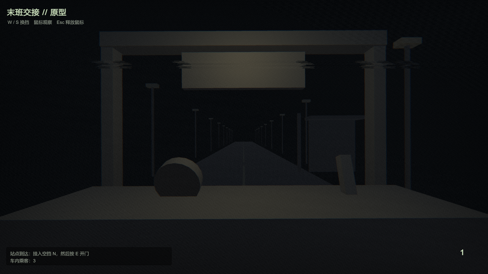
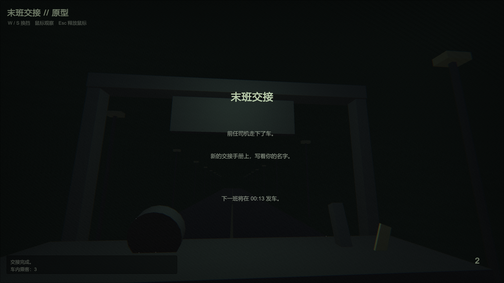

# The Last Handover / 末班交接

A short analog-horror driving puzzle made for GitHub Game Off 2026: **SHIFT**.

You are taking over the final night bus. The gearbox does more than change speed: each gear reveals a different version of the road. Follow the handover manual, identify impossible passengers, and never select the gear that should not exist.

## Current milestone

**Prototype 0.5** — five anomaly beats, fully playable end to end:

1. **The fourth passenger** — the counter says four; the manual says three. Observe in second gear, then let the impossible one off in neutral.
2. **The repeating stop** — the same sign keeps coming back. Silence the engine, listen through the static, and confirm the true last-but-one stop.
3. **The figure in the road** — someone is standing in the rain where they should not be. It does not hide from the rain. Keep driving.
4. **The mirror driver** — someone extra is driving from the rear-view mirror. Force it to match you in third, then break it down to first.
5. **The fifth gear** — after the mirror event, a new notch appears beside the lever that was never there. Hold **Shift** until it reveals itself, keep holding, and shift in. The handover is complete — and the next bus departs at 00:13.

All visuals, audio and the VHS post-process are generated procedurally; the project intentionally contains no external assets. Rain sweeps the windshield, the wipers never stop, and the radio mostly keeps static.

## Controls

- Mouse: look around
- W / Up: shift up (N → 1 → 2 → 3)
- S / Down: shift down
- E: open the door / confirm at stops
- Shift (hold): reveal the gear that should not exist
- Escape: release or capture mouse

## Unity

Unity 6000.3.27f2. Open `TheLastHandover` as the project folder. A Windows build lives at `Builds/Prototype/TheLastHandover.exe`.

## License

Project code will be released under the MIT License. Third-party assets, if added, will retain their original licenses and be listed in `THIRD_PARTY.md`.
